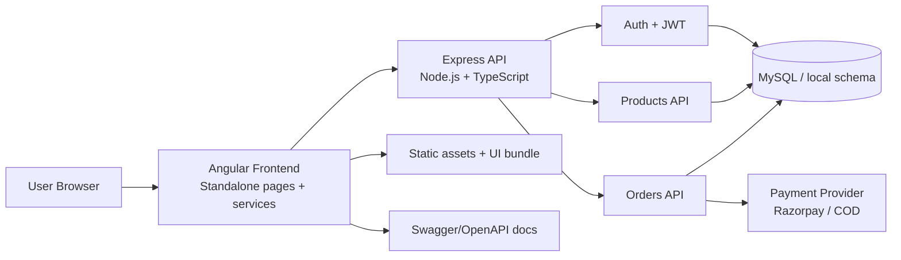

# ABC LED System Design

## Components

### Frontend
- Angular 21 storefront with routes for homepage, products, cart, checkout, auth, and dashboards.
- Uses standalone components and a service layer to keep API calls and UI state separated.

### Backend
- Express server with CORS, helmet, JWT auth, and order/product endpoints.
- API route modules are separated by responsibility for maintainability.

### Data layer
- Canonical schema exists in `database/schema.sql` and supporting seed scripts for catalog and user data.
- The project supports graceful fallback to mock product data when database connectivity is unavailable.

### Observability and API contracts
- Swagger UI is served at `/docs` and JSON at `/docs-json`.
- Endpoints are validated by automated API tests to keep the contract stable.
